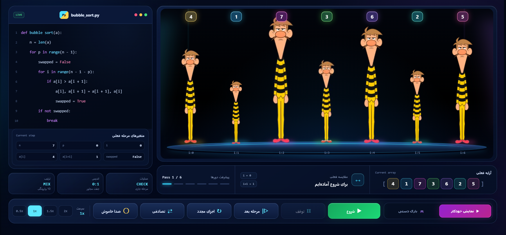

# 🤖 ربات تصویری مرتب‌سازی حبابی (BubbleSortRobot)

یک پروژه تعاملی و آموزشی برای نمایش الگوریتم مرتب‌سازی حبابی (Bubble Sort) با استفاده از React و TypeScript.

در این پروژه، عملکرد الگوریتم مرتب‌سازی حبابی به‌صورت تصویری و مرحله‌به‌مرحله نمایش داده می‌شود تا درک نحوه مقایسه و جابه‌جایی عناصر آرایه ساده‌تر و جذاب‌تر باشد.

## 🖥️ پیش‌نمایش پروژه



## ✨ امکانات پروژه

- نمایش تصویری الگوریتم Bubble Sort
- اجرای مرحله‌به‌مرحله عملیات مرتب‌سازی
- استفاده از شخصیت‌های متحرک برای نمایش عناصر آرایه
- نمایش تغییرات آرایه به‌صورت زنده
- نمایش متغیرهای الگوریتم در هر مرحله
- امکان تنظیم سرعت انیمیشن
- قابلیت توقف و ادامه اجرای الگوریتم
- تولید آرایه تصادفی
- اجرای دستی و خودکار مرتب‌سازی
- رابط کاربری تعاملی و مدرن

## 🛠️ تکنولوژی‌های استفاده‌شده

- React
- TypeScript
- Vite
- CSS

## 📥 راهنمای نصب و اجرا

برای اجرای پروژه روی سیستم خودت، مراحل زیر را دنبال کن.

### مرحله اول: دریافت پروژه

ابتدا مخزن را با دستور زیر دریافت کن:

```bash
git clone YOUR_REPOSITORY_URL
```

### مرحله دوم: ورود به پوشه پروژه

```bash
cd BubbleSortRobot
```

### مرحله سوم: نصب وابستگی‌ها

```bash
npm install
```

### مرحله چهارم: اجرای پروژه

```bash
npm run dev
```

پس از اجرای دستور، آدرس محلی نمایش‌داده‌شده در ترمینال را در مرورگر باز کن.

## 🏗️ ساخت نسخه نهایی پروژه

برای ساخت نسخه Production از دستور زیر استفاده کن:

```bash
npm run build
```

برای مشاهده نسخه نهایی نیز می‌توانی از دستور زیر استفاده کنی:

```bash
npm run preview
```

## 📂 فایل‌های آموزشی و منابع پروژه

علاوه بر فایل‌های اصلی پروژه، منابعی برای آشنایی با روند ساخت آن نیز در نظر گرفته شده است.

### 📸 تصویر پروژه

اسکرین‌شات اصلی پروژه در مسیر زیر قرار دارد:

```text
public/images/stage/Screenshot.png
```

### 🤖 پرامپت و راهنمای ساخت پروژه

پرامپت اصلی و تصویر راهنمای استفاده از آن در مسیر زیر قرار دارند:

```text
public/
└── prompt/
    ├── Prompt.txt
    └── راهنمای-پرامپت.png
```

با استفاده از این فایل‌ها می‌توانی پرامپت را به همراه تصاویر مرجع در اختیار **ChatGPT Codex** قرار بدهی و از آن برای بررسی روند ساخت پروژه استفاده کنی.

## 📚 هدف پروژه

هدف از ساخت این پروژه، نمایش جذاب‌تر مفاهیم برنامه‌نویسی و الگوریتم‌ها و تبدیل فرایندهای منطقی به تجربه‌ای تعاملی و قابل درک است.

---

**ساخته‌شده با ❤️ توسط مرتضی صالحی نژاد برای علاقه‌مندان به برنامه‌نویسی و هوش مصنوعی**
